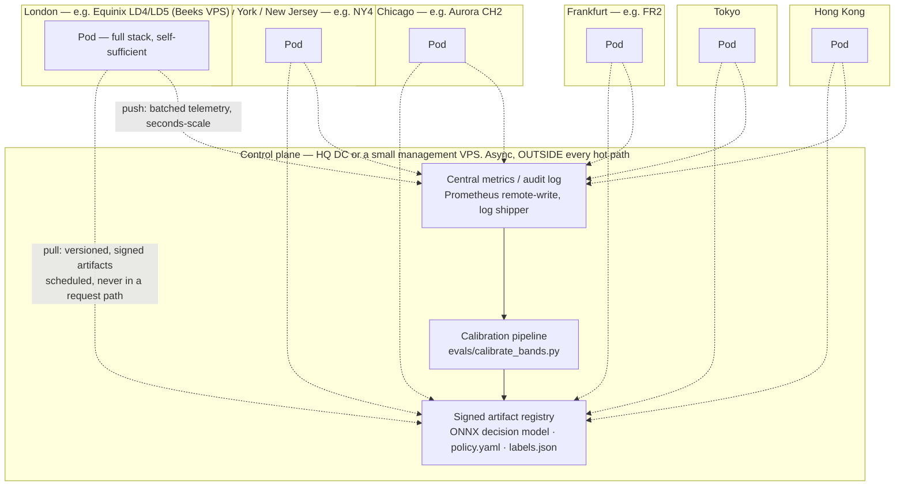
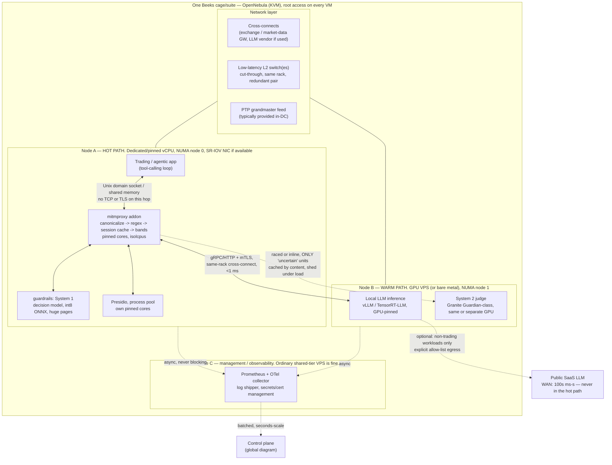

# Deploying the firewall on-prem / colocated, on low-latency trading infrastructure

Status: reference architecture. Written against the characteristics described for
Beeks Group VPS (root-access VMs on an OpenNebula/KVM fleet, in major financial
data centers, SOC2/ISO27001) — the same design applies to any colocation provider
with comparable properties (dedicated/pinned resources, root access, cross-connects
to venues, PTP feeds). Specific product tiers (SR-IOV availability, GPU add-ons,
bare-metal options) vary by provider; treat the provider-specific items here as
**questions to confirm**, not guarantees (§7).

## 0. Framing: what kind of "low latency" is this

Trading colocation exists to win microseconds on order entry and market data. An
LLM call cannot compete at that timescale — a quantized small model still takes
single-digit-to-tens of milliseconds, and a judge-class LLM takes hundreds. This
firewall sits one layer up, in front of an **agentic / decision-support** system
(a trading bot or analyst-support agent calling an LLM for reasoning, research, or
tool use), not in the order-entry path itself. The goal here is the same discipline
applied at a different timescale: a network firewall has the WAF equivalent; an
order-entry gateway has a pre-trade risk check, often FPGA/ASIC-accelerated,
sub-microsecond. **This proxy is the pre-trade-risk-check equivalent for
LLM-driven actions** — and the realistic target is to make *everything except
model inference* (network hops, (de)serialization, TLS, GC/scheduler jitter)
small enough that inference time is the only thing left on the bill. That is
what the System-1 / System-2 split (previous sections of this repo) already
buys: a sub-100-µs-class deterministic gate for the common case, with the slow
judge raced or shed instead of sitting on the critical path.

Consequently the single highest-leverage infrastructure decision is: **host the
LLM inference itself in the same low-latency domain as the firewall and the
agent.** Calling a public SaaS LLM over the WAN (100s of ms – seconds, plus
egress through a public internet path a trading cage often does not want open at
all) defeats the purpose of colocating anything. SaaS LLMs have a place here only
for work that is explicitly *not* latency-critical (§5).

## 1. Global topology: one self-sufficient pod per venue

Each venue gets its own complete, independent pod (§2): agent, firewall, decision
model and local LLM inference all local to that data center. No decision in the
hot path ever crosses a WAN link. The control plane is explicitly **not** a
dependency of any live request — pods pull new model/policy artifacts on a
schedule (or on manual promotion) and push telemetry asynchronously; if the
control plane is unreachable, every pod keeps running on its last-known-good
artifacts. This mirrors the repo's existing fail-mode philosophy (fail
closed/open *per category*, never on an external dependency in the request path)
and the System-2 load-shedding design (degrade gracefully, never block).

## 2. One pod, in detail

Three nodes, not one, because they have different resource shapes and different
blast-radius requirements:

* **Node A** is CPU-bound, latency-critical, and small (the whole point of the
  System-1 gate is that it's cheap). It gets the smallest, most aggressively
  tuned VM, pinned cores, and — if this is the component on the critical path to
  an order — the option to move to bare metal (§7) to remove the hypervisor tax
  entirely.
* **Node B** needs a GPU and is where System 2 and local LLM inference live.
  It is *not* latency-critical in the same sense: the whole design (racing,
  caching, shedding, session risk) exists so that node B's latency is hidden or
  bounded, not eliminated.
* **Node C** is ordinary infrastructure (metrics, logs, secrets) that must never
  share a blast radius or a noisy-neighbour core with node A.

If the cage only has one VM available, all three can collapse onto it (see the
Docker Compose profile structure already in this repo — `guardian` is already a
separate, optional service) — at the cost of losing the CPU/GPU isolation and
the blast-radius separation. That's a reasonable tradeoff for a PoC; not for a
production pod.

## 3. Component placement

| Component | Node | Why there |
|---|---|---|
| Agent / trading app | A | Issues the calls the firewall screens; same host as the firewall removes a network hop entirely |
| `mitmproxy` addon (`firewall_addon.py`) | A | The tier-0 gate; must be on the hot path's critical section |
| `guardrails` service — System 1 (`/v1/decide`) | A | Sub-tens-of-ms budget; CPU-only int8 ONNX is intentionally not GPU-bound, so it belongs with the agent, not the GPU node |
| Presidio / PII | A | Process pool, per `bench/controlled` findings — CPU work, not GPU work |
| Local LLM inference (vLLM/TensorRT-LLM) | B | GPU-bound; this is the thing System 1/2 exist to protect the latency budget *around* |
| System 2 judge (`system2.py` target) | B | GPU-bound, shares the card/rack with local inference; only reached for the uncertain minority |
| `nginx` (TLS edge) | A, only if an external-facing hop exists | Internal node-to-node hops use mTLS gRPC/HTTP directly, not a public TLS edge; keep nginx only where a non-colocated caller needs to terminate TLS from outside the cage |
| Prometheus / OTel / logs / secrets | C | Must not compete for cores with A or B; async only |
| `evals/calibrate_bands.py`, model export/training | Control plane (outside the pod) | Batch, off-line, never touches a live request |

## 4. Hot-path latency budget

Orders of magnitude matter more than exact numbers here; measure the real ones
with the PTP-timestamped path once deployed.

| Hop | Typical order of magnitude | Notes |
|---|---|---|
| Unix domain socket / shared-memory IPC, same host | ~1–20 µs | Agent ↔ firewall on node A; avoid a TCP/TLS hop here entirely if the agent and firewall can be co-processes |
| Same-rack cross-connect, cut-through switch, kernel-bypass NIC | low single-digit µs – tens of µs | Node A ↔ node B; SR-IOV / DPDK / Onload-class stack removes the usual Linux network-stack overhead (often the larger share of this hop on a stock VM) |
| Same-rack hop, stock virtio NIC, normal kernel network stack | tens of µs – low hundreds of µs | What you get without the tuning in §6; still fine for this workload, just less deterministic (more jitter) |
| **System-1 decision (CPU, int8 ONNX, one pass, one window)** | **single-digit ms** | Dominates the budget; this is the number the controlled benchmarks (`bench/controlled/REPORT.md`) model as `s1_window_ms` |
| **System-2 judge (GPU LLM, 1-token decode)** | **tens – low hundreds of ms** | Why it is raced/cached/shed rather than put inline on every request |
| Local LLM inference (the agent's actual model call) | tens of ms – low seconds, model-size dependent | Usually the largest number on the page even with everything else optimal — another reason System-2 racing against it is "free" when it works |
| WAN round-trip to a public SaaS LLM endpoint | **100+ ms, often 1–2 s+** | 2–5 orders of magnitude above everything else; do not put this in the hot path of a colocated deployment |

The practical conclusion: software/network tuning buys microseconds to low
milliseconds; it cannot make an LLM-based gate compete with order-entry
timescales, and it does not need to — it needs to stop being the bottleneck
relative to the model inference that's happening anyway.

## 5. Why the upstream model must be local here (and when SaaS is still fine)

The existing README frames this proxy as inline between the caller and "an
OpenAI-compatible model API." In a colocated deployment that upstream should be
**your own inference endpoint** (vLLM, TensorRT-LLM, or similar) running on node
B, reached over the cage's internal network. Reserve a public SaaS LLM for:

* asynchronous, non-trading workflows (document summarisation, after-the-fact
  compliance review, calibration-data generation) where a WAN hop is a
  non-issue;
* a deliberately out-of-band "second opinion" path that is never awaited by the
  live agent.

If a SaaS LLM must be reached from inside the cage at all, route it through an
explicit, narrowly allow-listed egress path (§8) — not the general internet
egress a trading cage usually disables outright.

## 6. Host and network tuning checklist

Everything here is standard low-latency Linux/KVM practice; Beeks-style root
access on the VM is what makes it possible to apply at the guest level even
without bare metal.

**Virtualization (ask the provider, or apply if self-managed OpenNebula):**
- Dedicated, pinned vCPUs — not overcommitted (the product description's
  "dedicated vCPU" is necessary but confirm it means *pinned*, not just
  *reserved-but-floating*, with the provider).
- NUMA-aware placement: request (or configure, if you manage the OpenNebula
  host) `TOPOLOGY`/`PIN_POLICY=CORE` so the guest's vCPUs, memory and NIC queues
  land on one NUMA node.
- SR-IOV NIC passthrough if offered, to skip `virtio-net`/`vhost` overhead on
  the node A ↔ node B hop and on any exchange/market-data cross-connect.
- Ask whether a bare-metal tier is available for node A specifically (§7).

**Guest OS / kernel (root access, apply directly):**
- `isolcpus` / `nohz_full` / `rcu_nocbs` on the cores running the addon and
  System-1 workers (set at boot via kernel cmdline — bake into the VM image).
- CPU governor `performance`, C-states disabled for those cores
  (`cpupower idle-set`), to remove frequency-scaling latency spikes.
- IRQ affinity: steer NIC interrupts to cores *not* used by the pinned
  firewall/model processes.
- Huge pages (`transparent_hugepage=madvise`, explicit `hugepages=` reserved)
  for the ONNX Runtime / PyTorch processes — reduces TLB-miss jitter.
- Disable `numa_balancing` once placement is pinned — automatic rebalancing is
  exactly the kind of non-determinism this tuning is trying to remove.
- `SO_BUSY_POLL` / kernel-bypass socket options, or a vendor stack
  (Solarflare Onload / Mellanox VMA) if the provider's NIC supports it, for the
  node-to-node hop.
- PTP client (`ptp4l`/`chrony` with a PTP source) synced to the facility's
  grandmaster — needed to trust any cross-host latency measurement at all, and
  useful for `bench/controlled`-style latency attribution against production
  traffic (§9).

**Application layer (already true of this repo, reiterated here because it
matters most in this environment):**
- Keep `GUARDRAILS_WORKERS × ORT_INTRA_THREADS ≤ pinned cores` (see
  `bench/controlled`) — oversubscription is worse here than on a shared VM,
  because jitter on a pinned/isolated core shows up directly in the venue's
  clock, not hidden by a noisy neighbour's scheduler slack.
- Prefer the Unix-socket transport already supported by `classifier_client.py`
  (`GUARDRAILS_UDS`) for the node-internal hop if the firewall and System-1
  service are containers on the same VM.
- `S2_MODE=race`, not `inline`, in this environment by default — the whole
  reason to race is to hide exactly the kind of hop this section is trying to
  shrink everywhere else.

## 7. Bare metal vs VPS for node A

A KVM-backed VPS (OpenNebula's hypervisor) still carries a hypervisor tax:
scheduling jitter from the host kernel, a virtualized or SR-IOV-passthrough NIC,
and (unless pinned) exposure to noisy neighbours. For node A specifically —
small, CPU-only, latency-sensitive — ask the provider whether a bare-metal tier
exists alongside the VPS product for this single node, while node B (GPU,
naturally coarser-grained) and node C (not latency-sensitive at all) stay on
VPS. This is a narrow, specific upgrade, not a blanket recommendation to avoid
virtualization — most of the budget in §4 is dominated by model inference, not
by the hypervisor.

## 8. Security and compliance mapping

The product description's SOC2/ISO27001 backing is an attestation about the
provider's facility and operations; it does not substitute for the tenant's own
controls inside the VM. Map this repo's existing posture onto it:

* **No general internet egress from node A or B.** Only explicit allow-listed
  destinations: the local LLM endpoint (internal), the control-plane pull
  endpoint (outbound, scheduled, not request-path), and — only if genuinely
  needed — a narrowly scoped SaaS LLM egress per §5.
* **Secrets** (API keys, mTLS material) in a secrets manager (e.g. Vault) or at
  minimum root-owned, mode-600 files injected via the VM's contextualization —
  never baked into the image.
* **PII handling stays local**, as already documented (Presidio redaction
  in-proxy) — nothing about colocating changes that property; if anything it
  strengthens the case, since the whole premise of this deployment is that nothing
  leaves the cage.
* **Audit log / escalation log** (`ESCALATION_LOG`) ships asynchronously to node
  C and from there to the control plane's SIEM — never synchronously, and never
  blocking a request if the shipper is down.
* **Signed, versioned artifact promotion** for the decision model, `labels.json`
  and policy config (the control plane's `Reg` in §1) — the same change-control
  discipline a trading firm already applies to strategy code should apply to
  these, since they directly decide what gets blocked or allowed.
* **Change windows**: because pods pull on a schedule rather than live, a bad
  model/policy push can be caught and rolled back centrally before every venue
  picks it up, and a single venue's rollout can be canaried before the rest.

## 9. Observability without touching the hot path

Reuse the PTP sync from §6: timestamp requests at the addon (entry), at the
System-1 decision, at the System-2 race start/settle, and at the upstream call,
and ship those timestamps asynchronously to node C. That gives you, on real
traffic, exactly the per-stage breakdown `bench/controlled/REPORT.md` gives you
in simulation — which is the point of having built the simulation on a virtual
clock with the same stage boundaries as the real code (`vclock.py`,
`firewall_addon.py`). Treat the controlled-benchmark numbers as the *shape* of
the expected breakdown and the PTP-timestamped production numbers as the
*ground truth* for this specific hardware.

## 10. Questions to put to the colocation provider before committing to a design

1. Are vCPUs pinned (dedicated, not just reserved) and is NUMA-aware placement
   available or requestable?
2. Is SR-IOV (or another kernel-bypass-capable NIC) available on the VPS
   product, or only on a bare-metal tier?
3. Is a PTP grandmaster feed available in the cage, and how is it delivered to
   a guest VM?
4. What cross-connect options exist between VPS instances in the same
   cage/suite, and between a VPS and a GPU/bare-metal box if those are separate
   products?
5. Is a GPU-enabled VPS tier offered, or does node B require bare metal / a
   colocated GPU chassis?
6. What does the egress policy allow by default, and how is a narrow allow-list
   configured?
7. What is actually covered by the SOC2/ISO27001 attestation (facility,
   hypervisor management, network) versus what remains the tenant's
   responsibility inside the VM?

## 11. Starting point in this repo

`deploy/colo/` has a docker-compose override (CPU pinning, host networking,
real-time scheduling capabilities, memlock for huge pages) and host-tuning
scripts to translate §6 into a first pass at an actual VM image. They are a
starting point to adapt to the specific NIC/kernel/provider, not a finished,
validated tuning profile — validate every setting against the real hardware and
driver before trusting it with production traffic.
